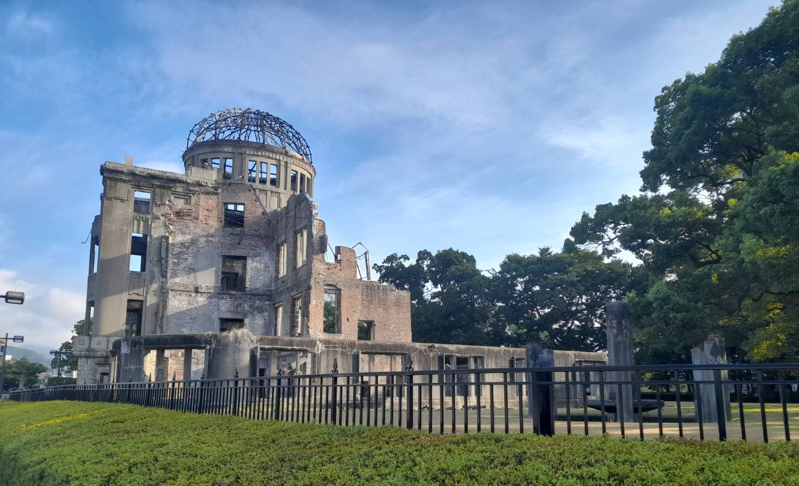
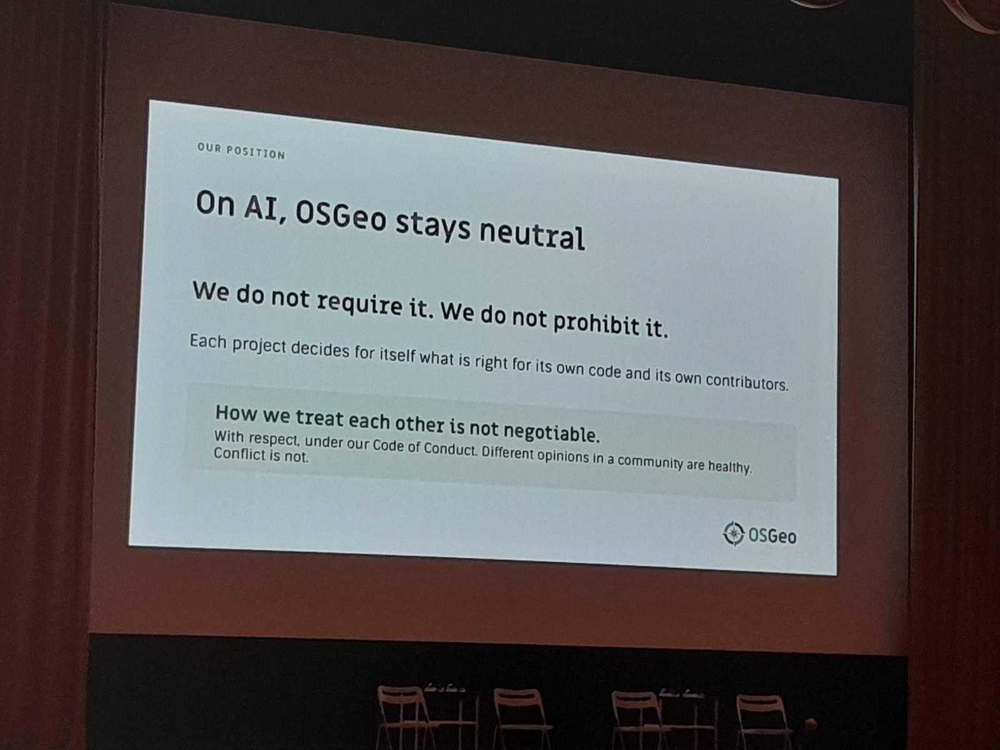
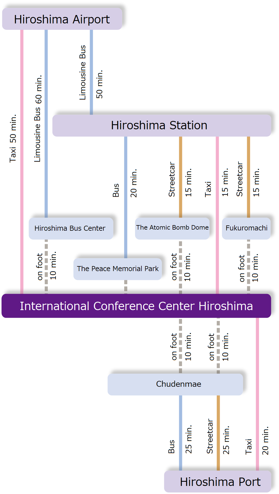
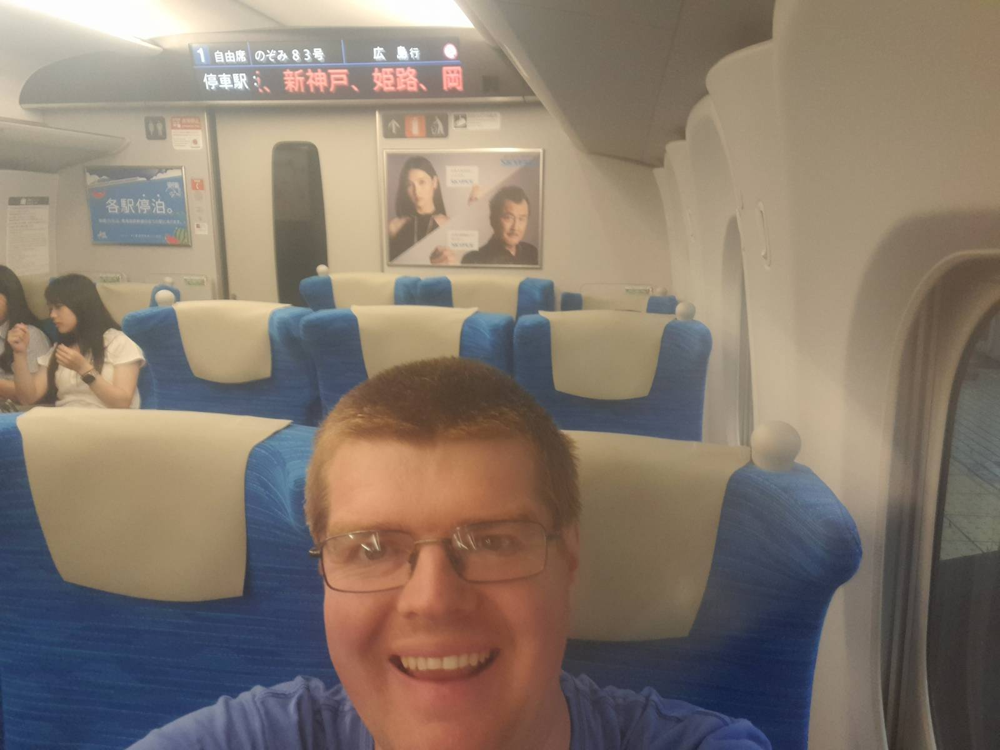
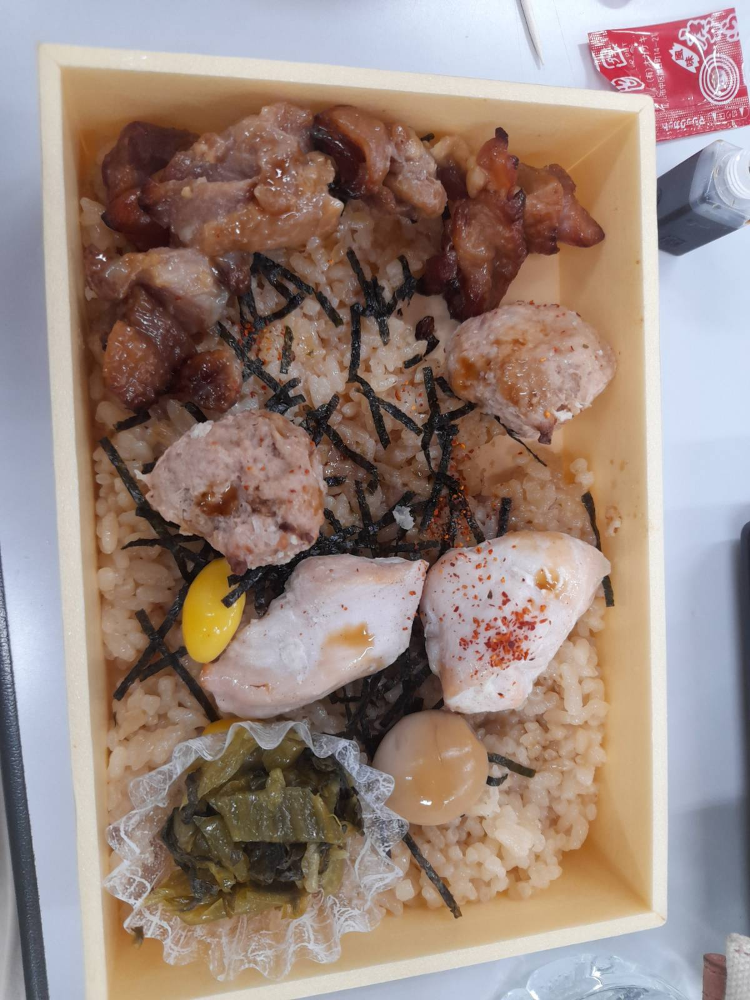
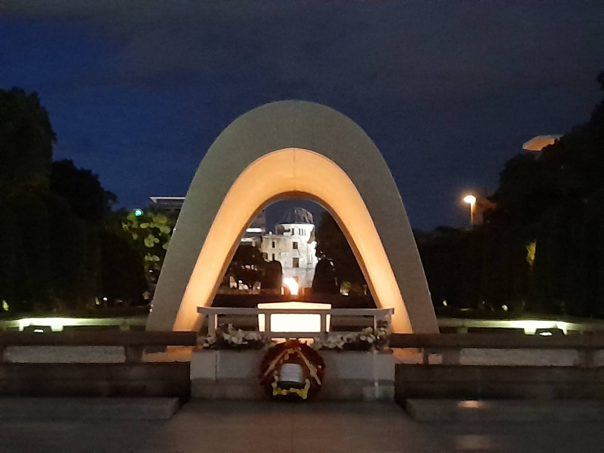

I was fortunate enough to be able to attend FOSS4G in Hiroshima, Japan, my third international FOSS4G conference. Japan is an amazing country - I have included some extra photos at the bottom if you are interested, and also a practical tip about booking trains!

Hiroshima is a fantastic setting, and we were based in the International Conference Centre, right next to the Peace Memorial Park commemorating lives lost when the nuclear weapon was dropped on Hiroshima during World War II, and their continuing campaign for nuclear disarmament and wider peace. The museum is well worth a visit if you ever have the opportunity, a thought provoking and humbling experience.



### FOSS4G 2026

The FOSS4G conference was excellent and an amazing opportunity to meet people, make new friends and refresh existing friendships. This year 828 people met together to talk about open source geospatial software, share their work and get comments and feedback.

One big topic (but not the only topic!) was AI, or more specifically Generative AI and Large Language Models. Many people are using them - and there were some really interesting presentations about the benefits of them, and new ideas of how we might work with them. One great presentation was [Teaching AI to Contribute to Open Source: Lessons from MapLibre Agent Skills](https://talks.osgeo.org/foss4g-2026/talk/RT8SMH/) where Stephanie May shared the experience of MapLibre working with AI agents. There was also a significant amount of discussion about not using AI, for a number of different reasons.

There is a larger discussion going on in the OSGeo and QGIS communities about the impact of these tools. A number of PRs have been submitted, particularly for QGIS, which are very hard to review and result in the core contributors wasting a lot of time trying to understand these changes. As a result, there is discussion about banning AI use with the QGIS codebase. This is still under active discussion, and as QGIS is an open project, you can see (and take part in if you want to) the discussions - for example via the [QGIS Developer list](https://lists.osgeo.org/pipermail/qgis-developer/) and QEPs on the QGIS GitHub page [here](https://github.com/qgis/QGIS-Enhancement-Proposals/pull/388) and [here](https://github.com/qgis/QGIS-Enhancement-Proposals/pull/387).

OSGeo made a statement that they are not taking a view on LLM usage and that it is for the individual projects to decide. This was mentioned in the opening ceremony and in the [OSGeo Board meeting minutes](https://wiki.osgeo.org/wiki/Board_Meeting_2026-07-28#AI_policy_discussion). Since this has been adopted, there has been a motion put forward to change this. It is a rapidly moving field, and sometimes I find it quite hard to keep up with developments.



There was also a great [AMA (Ask Me Anything)](https://talks.osgeo.org/foss4g-2026/talk/P9XGVU/) session on QGIS run by Marco Bernasocchi where people could ask anything they wanted to. I discovered the difference between a CRS (Coordinate Reference System) and a SRS (Spatial Reference System) - CRS is usual in QGIS, but SRS appears occasionally. A SRS includes a geoid, a CRS does not. Also one of the many limitations of the shapefile format is that you cannot reorder columns in it - in other formats, like geopackage, you can.

During the main conference, I also presented [gitRmap](https://talks.osgeo.org/foss4g-2026/talk/UYL89P/) as a lightning talk - it was great to share this tool with the world and get some useful feedback. One of the highlights for me was one of the keynote presentations [Sustaining Open Source: What We Can Learn from the Cooperative Model](https://talks.osgeo.org/foss4g-2026/talk/S9RDGB/) where Ela Kagel discussed elements from the Cooperative Model that might be useful for the Open Source community, and I also learnt about [Coop Cycle](https://coopcycle.org/en/), a group of cooperative based cycle couriers.

### Workshops

This year I had the opportunity to present a workshop at the conference. It was a great opportunity to share some R and GIS code with enthusiastic folks, and I also managed to sell a copy of my book, [Using R as a GIS](https://nickbearman.com/rgis.html), which is always a lovely feeling.

We also explored the inner workings of GDAL Virtual File Systems and after a bit of experimenting managed to be able to download, extract and read in a shapefile in one line. I probably won't be using it in the course - there's a lot going on in that one line - but it's a cool bit of code! Thanks! Check out [https://gdal.org/en/stable/user/virtual_file_systems.html](https://gdal.org/en/stable/user/virtual_file_systems.html) for more details.

```{r,eval=FALSE}
sthelens <- st_read("/vsizip//vsicurl/http://www.nickbearman.com/files/sthelens_lsoa_2021.zip")
```

I also attended three other workshops over the two days, including [Discovering PostGIS: An Introduction for QGIS Users](https://talks.osgeo.org/foss4g-2026-workshop/talk/SSQZQ3/),  [30 Maps in 3 Hours](https://talks.osgeo.org/foss4g-2026-workshop/talk/UA8G9H/) and [NextGIS Web for QGIS teams: from deployment to collaboration](https://talks.osgeo.org/foss4g-2026-workshop/talk/YVR8DV/). They were all really good workshops and one consistent thing across all of the workshops is people's passion about the tools they are talking about and willingness to share this knowledge with others. I find the workshops some of the most interesting bits of the conference - and I couldn't attend all that I wanted to. Fortunately most of the workshop convenors share their materials via [talks.osgeo.org](https://talks.osgeo.org/foss4g-2026-workshop/schedule/) so the material is available to work through later on.

The final day of the conference featured the code sprint, where I spent a bit of time working on gitRmap. I also received my first [PR](https://github.com/nickbearman/gitRmap/pull/6) for this from [Hiroaki Yutani](https://github.com/yutannihilation) working with me, so that was cool! I also managed to submit the first [PR](https://github.com/yutannihilation/ggplot2qgis/pull/23) to his project ggplot2qgis as well, so a great day for collaboration!

The conference is also a great time and place to meet people - I met a wide range of users and developers, some who I had heard of before and many who I had not. Everyone there is enthusiastic about open source geospatial and it is a special place to be. As usual, we had a group photo which is a great memory of the week:


### CaGIS, St Louis, USA

The following week I was also fortunate to be able to attend the CaGIS (Cartography and Geographic Information Society) conference in St Louis, MO, USA. I work as Cartographic Editor for CaGIS so it was a great opportunity to meet colleagues and authors who I exchange many emails with but rarely meet in person. This conference has a much more academic flavour than FOSS4G, and is also much smaller - about 120 people. We had two days of conference and one day of workshops, and also there was Geo-Resolution as well, which is a one day conference for the Geospatial Intelligence and Defence communities, which have a large presence in St. Louis and the surrounding areas. It's a very different flavour again and always interesting to see how different people use geospatial.

### Booking Trains in Japan

My travel plans included getting the train from Tokyo to Hiroshima. While Hiroshima does have an airport, my flight into Japan came in to Tokyo. The Japanese train service has a very good reputation, and the journey from Tokyo to Hiroshima is ~4.5 hours, so I decided to take the train instead. 

In fact, the conference venue travel page explicitly states "There is no air service between Hiroshima and Osaka, Nagoya or Fukuoka. The JR railway lines provide convenient access instead."

Thanks to [Seat61](https://www.seat61.com/Japan.htm), I found the train information via [Baolau](https://booking.baolau.com/en/). Japanese trains don't have advanced tickets - it is a flat fare whether you buy 1 month before or on the day. If you book ahead, you can reserve a seat, but for the journeys I'm making there are 2 or more trains an hour. So I booked the first one ahead of time (Tokyo to Hiroshima) but for the return journey, breaking in Kyoto, I will buy on the day.

*In the end I missed my scheduled train from Tokyo to Hiroshima - but you can just catch the next one, even with an advanced ticket. You just don't get a reserved seat.* 


::: columns
:::: {.column width="45%"}

I also particularly liked this graphic from the ICC website, about how to travel to the conference centre:



::::
:::: {.column width="45%"}



----



----



::::
:::
